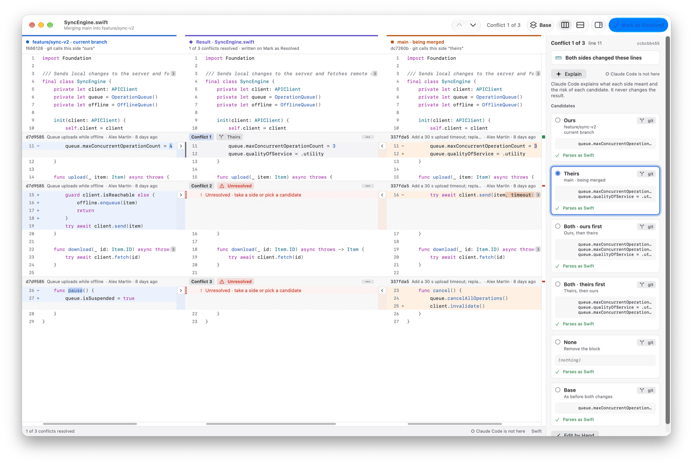
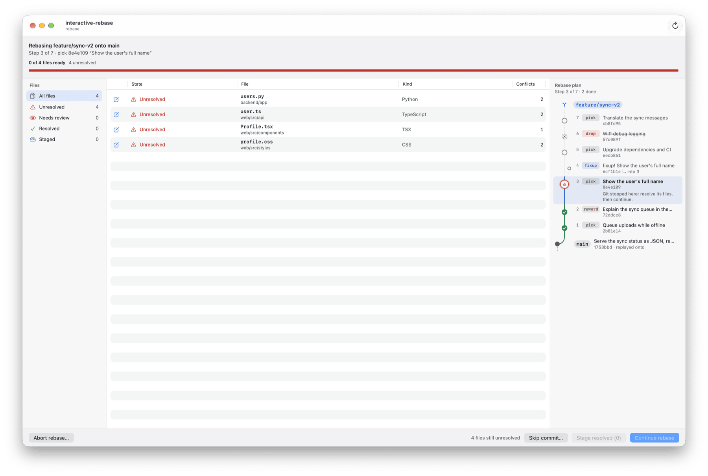
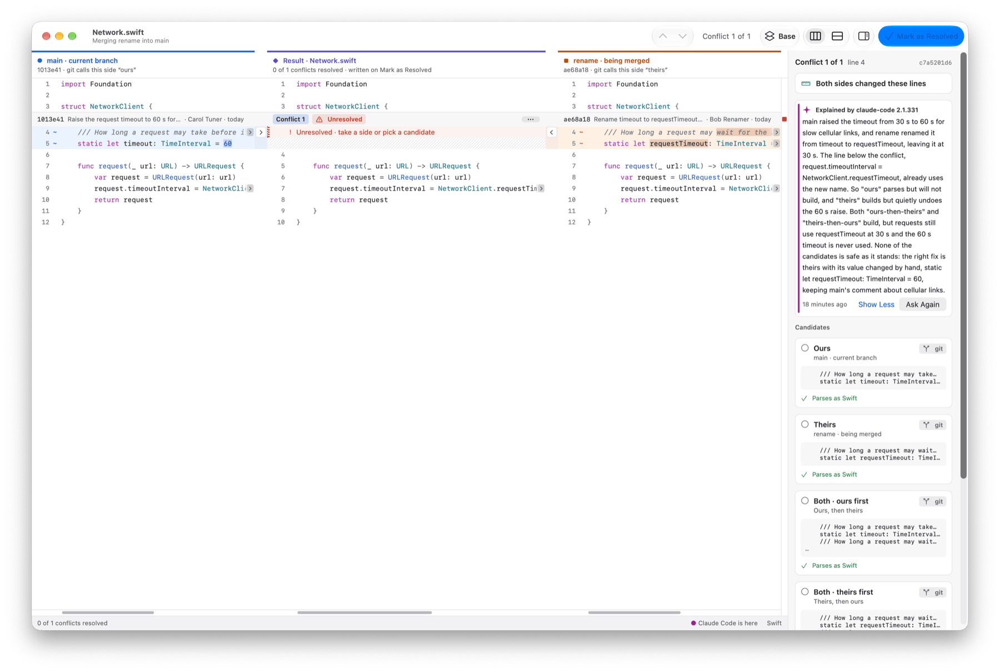
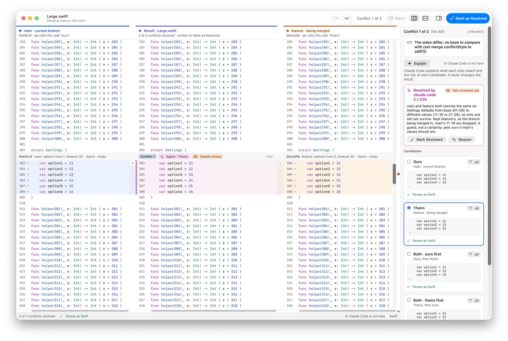

<p align="center">
  
</p>

<h1 align="center">Scry</h1>

<p align="center">
  <strong>See through your merge conflicts.</strong><br>
  A local-first merge and diff tool for git: a native macOS app and the <code>git scry</code> command.
</p>

Scry (`git-scry`) is a local-first tool, integrated with git, for merging and reviewing changes. It resolves conflicts through `git mergetool`, opens the whole operation in a native app, checks each choice by parsing the file, and works with your Claude Code: your agent resolves, explains and proposes resolutions through Scry's plugin, you review in Scry. It also reads a change before you commit it: the files that differ, each one whole, with its history, its blame and Explain on the lines you select.

Status: version 0.2.0 is the first public release: the merge tool (the macOS app and the `git-scry` CLI) and the Claude Code plugin. The diff viewer described below is on `main` and ships with the next release. Review of branches and pull requests comes next (see [Roadmap](#roadmap)).



## Install

With [Homebrew](https://brew.sh), one line installs the app and the `git scry` command:

```sh
brew install hnic0las/scry/scry
```

Then go to step 3. Without Homebrew:

1. **The app.** Download Scry from the [releases](https://github.com/hnic0las/scry/releases/latest) and move it to the Applications folder, or build it from this repository (`scripts/install-app.sh`, see [macOS app](#macos-app)). It needs macOS 15 or later on a Mac with Apple silicon.
2. **The `git scry` command.** Scry › Settings › CLI › **Install git scry** links the app's `git-scry` into a folder of your terminal's `PATH` (the first of `~/.local/bin`, `/opt/homebrew/bin` or `/usr/local/bin` it can write to), or shows the commands to run when it cannot. The link follows the app's updates.
3. **git's merge tool** (optional). Scry › Settings › CLI › **Use Scry as git's Merge Tool** sets `merge.tool`, `mergetool.scry.cmd` and `mergetool.scry.trustExitCode` in your global git configuration, and keeps the merge tool it replaces, to put it back with **Stop Using Scry**. **Use Scry as git's Diff Tool** does the same for `git difftool`; `git scry diff` needs no setting.
4. **Claude Code** (optional). Scry › Settings › Agent › **Install Scry's Plugin**, or in a terminal:

   ```sh
   claude plugin marketplace add hnic0las/scry
   claude plugin install git-scry@scry
   ```

   or, inside Claude Code, `/plugin marketplace add hnic0las/scry` then `/plugin install git-scry@scry`. Then restart your Claude Code sessions: a session loads its plugins when it starts. The plugin runs the app's `git-scry`, so install the app first.

## Use

To read a change, in any repository:

| Where | What | Does |
|---|---|---|
| Terminal | `git scry` | With no operation in progress, opens the app on everything not committed, as `git scry diff` does |
| Terminal | `git scry diff` | Opens everything not committed: staged, not staged and new files |
| Terminal | `git scry diff --staged` | Opens what the next commit holds |
| Terminal | `git scry diff main`, `main..topic`, `main...topic` | Opens the working copy against a commit, one commit against another, or a branch against its merge base |
| Terminal | `git scry diff --print` | Prints the list of files instead (`--print=unified` or `--print=split` for each file whole) |
| Terminal | `git scry log <file>` | Opens one file's history, followed through its renames (`--print` to list it) |
| Terminal | `git difftool` | Opens each file in a reduced window, once Scry is git's diff tool |
| Scry | ⌥⌘↓ and ⌥⌘↑, ⌃⌘↓ and ⌃⌘↑ | Next and previous change, next and previous file |
| Scry | ⌥⌘L | Unified or split |
| Scry | ⌥⌘V | Marks the file viewed and goes to the next one that is not |
| Scry | ⌘Y, ⌥⌘B | The file's history, and blame |
| Scry | ⌃⌘E on selected lines | Explain: your Claude Code session open in the repository says what the lines do and why they changed |

In a repository with a merge, rebase, cherry-pick or revert in progress:

| Where | What | Does |
|---|---|---|
| Terminal | `git scry` | Opens the app on the operation's overview, from any folder of the repository |
| Terminal | `git mergetool` | Opens each conflicted file in Scry, once Scry is git's merge tool |
| Terminal | `git scry session` | Prints the operation, who is on each side and the files left with conflicts |
| Terminal | `git scry conflicts <file>` | Prints a file's conflicts and the size of each side |
| Terminal | `git scry highlight <file>` | Prints a file with the app's syntax colours (`--spans` to list them) |
| Claude Code | `/git-scry:resolve [path]` | Your agent resolves the conflicts, each with its reason, and stages nothing |
| Scry | ⌃⌘E on a conflict | Explain: your Claude Code session open in the repository says what each side meant |
| Scry | ⌃⌘G on a conflict | Suggest: that session proposes a resolution, for you to accept, edit or reject |
| Scry | ⌘/ | Every keyboard shortcut |

Two more commands are for the plugin, not for you to run: `git scry mcp` (Scry's MCP server) and `git scry wait` (prints each Explain or Suggest you ask for in Scry).

## Settings

- **CLI**: the `git scry` command (Install git scry), Scry as git's merge tool (Use Scry as git's Merge Tool, Stop Using Scry) and as git's diff tool (Use Scry as git's Diff Tool), each with the command git runs for each file.
- **Agent**:
  - **Claude Code**: whether Claude Code and Scry's plugin are installed, with Install Scry's Plugin, Turn On Scry's Plugin, Uninstall from Claude Code, and the two commands to copy. Installing also adds to Claude Code's user settings (`~/.claude/settings.json`) the rules that let the plugin's read tools, `explain` and `suggest` run without asking, so Explain and Suggest are never stopped by a question; `resolve`, which writes your files, still asks. Uninstalling removes those rules. Warnings, each with its button: an earlier Scry's `scry` server, registered with `claude mcp add`, which made Claude Code show Scry twice (Remove the Earlier Server); the plugin's tools not allowed yet (Allow Scry's Tools); the plugin unable to find Scry (move Scry to Applications, or install the `git scry` command).
  - **Explain and Suggest**: the switch "Explain and suggest with Claude Code", on by default. Off, there is no Explain or Suggest anywhere in Scry; answers already received are hidden, not deleted.
- **Appearance**: the merge editor's layout, three columns or the sides above the result.

<p align="center"></p>

## Features

### The whole operation at a glance



- A merge, rebase, cherry-pick or revert opens on its **overview**: the conflicted files and their state, and who is on each side.
- A rebase shows its **plan as a graph**: each pick, reword, fixup or drop, where git stopped, and which steps it ran on its own. A merge shows both branches since their merge base.
- **Drive the operation from the app**: Stage and Unstage per file (Unstage hands the conflict back to git and keeps your resolution), Stage resolved, Continue, Skip and Abort.
- A `reword` step asks for the commit message in the overview, before Continue: git never opens an editor of its own.

### Conflict by conflict

- **One key per choice**: ours, theirs, both in either order, base or none, from the keyboard, the lens row's menu, the › ‹ buttons beside each conflict or the inspector.
- **Edit the result by hand**, conflict by conflict, with undo and redo throughout.
- **Your choices are kept**: a file resolved in Scry, in the app or through `git mergetool`, opens again with the candidate or the text you chose for each conflict, as long as the file still holds it.
- **Word-level differences** and **syntax highlighting** in the three panes.
- **Show the base** (⌥⌘B) under each conflict, to see what both sides changed from.
- **Two layouts**: three columns, or both sides above the result (⌥⌘L). The second is chosen automatically in a narrow window.
- **Overview ruler**: one mark per conflict, coloured by its state; click one to go to it.
- Synchronised scrolling, horizontal included, and every shortcut listed in Help › Keyboard Shortcuts (⌘/).

### Checked before it is written

- In **19 languages** (Swift, Objective-C, C, C++, Rust, JavaScript, TypeScript, TSX, HTML, CSS, Python, Kotlin, Java, Go, Ruby, Bash, JSON including `.xcstrings`, YAML, TOML), Scry parses each candidate and marks the ones that would break the file, at the line of the error.
- A file that would not parse is written only after you confirm it.
- Merging an **Xcode project**, Scry checks that every reference still points to an object.

### Files a text merge gets wrong

Each of these gets its own view:

- a file **deleted on one side**: keep it or delete it;
- a **binary file**: take one version, with an image preview;
- an **Xcode project** (`.pbxproj`): keep both sides' additions;
- a **String Catalog**: merge key by key;
- **`Package.resolved`**: merge package by package, each pin whole;
- **lockfiles from 18 package managers** (`package-lock.json`, `yarn.lock`, `pnpm-lock.yaml`, `bun.lock`, `deno.lock`, `Cargo.lock`, `Podfile.lock`, `Cartfile.resolved`, `Gemfile.lock`, `poetry.lock`, `uv.lock`, `Pipfile.lock`, `composer.lock`, `pubspec.lock`, `gradle.lockfile`, `flake.lock`, `mix.lock`, `go.sum`): take one side, see the packages each side changed and the command that writes the file again. `go.sum` can also keep both sides' lines.

### Reading a change

Screenshots of the diff viewer are still to come.

- **The whole change in one window**: `git scry diff` lists the files that differ and shows the selected one **whole**, not as hunks, with its changes coloured in place, syntax colours and word-level marks. Unified by default, or split (⌥⌘L).
- **The list as you want it**: by folder or flat, in git's groups (Staged, Not staged, Untracked) for what is not committed. A change map beside the file has one mark per block; ⌥⌘↓ goes from block to block, then to the next file.
- **Viewed** (⌥⌘V): mark a file once read. The mark is tied to the file's content: a file that changes afterwards says "changed since viewed". A folder closes when all its files are viewed, and a right click on a folder or a group marks all its files.
- **Live**: the window follows the repository while you, or an agent, write in it. The lines you are reading stay where they are, and files that changed or arrived get a dot.
- **The inspector** (⌃⌘I) says what the file is (state, lines, sizes, last commit) and lists its blocks; a click goes to one.
- **One file's history** (⌘Y, or `git scry log <file>`): what is not committed of it, then each commit that touched it, followed through its renames, each against its parent or against a point you pin.
- **Blame** (⌥⌘B): who last wrote each line and when, beside the code; a click on a line opens the history on its commit.
- **Explain the selected lines** (⌃⌘E): click line numbers to select whole lines, and your Claude Code session says what they do and why they changed. The explanation stays with its lines, and says so when they changed after it was written. Nothing is written to your files.
- **`git difftool`** opens Scry too, in a reduced window: git hands over two files and nothing else, so it has no list, no history and no blame.
- Read only: the diff viewer never stages, commits or changes a file.

### With Claude Code

Scry works with Claude Code through its plugin, `git-scry`, and through your own Claude Code session: no API key, no account of Scry's, and Scry never starts Claude Code.

- **Your agent resolves, you review.** Scry's MCP server gives your agent the operation, each conflict's sides, base, candidates checked by parsing and the commits behind each side (`overview`, `conflicts`, `conflict`), instead of whole files and `git log`. Its `resolve` writes one conflict's lines with the agent's reason, never a resolution someone else made, and stages nothing. Type `/git-scry:resolve` in Claude Code, then review each resolution in Scry: the inspector shows who resolved it and why, with Mark Reviewed and Reopen, and staging a file not fully reviewed asks first.
- **Explain** (⌃⌘E) a conflict in Scry: what each side meant, the risk of each candidate, and which one looks safe. Keep a Claude Code session open in the repository: the plugin watches for Scry's asks (a monitor running `git scry wait --follow`) and hands each to a helper agent in the background, so your conversation goes on; the answer shows in the inspector within seconds, with who wrote it. The status bar says whether a session is there ("Claude Code is here"); an ask made while none is waits for one. The helper runs on your session's model, can read and search the repository, and writes only its answer, under the git folder; it never changes the result. Your session writes one short line when it starts the helper, and one when the answer is ready.
- **Suggest** (⌃⌘G) a resolution for a conflict, asked the same way and answered by a second helper agent. The proposal shows in the inspector as the agent's card: one of the candidates or its own text, its reason, what it leaves out of either side, and whether the file parses with it. Accept it (⌘Z undoes), Edit it by hand, Reject it or Ask Again. The agent writes nothing to your file: the proposal is written with your other choices when you mark the file resolved, and the file then reopens as resolved by Claude Code, reviewed by you.
- Everything an agent did is marked with its source; nothing is staged, committed or pushed by an agent.





### In your workflow

- **`git mergetool`**, in the app or in the terminal with the same digits as the app's shortcuts.
- **`git difftool`**, and **`git scry diff`** and **`git scry log`** for the whole change and one file's history.
- **`git scry`** opens the app on the operation in progress, or on what is not committed, from any folder of the repository.
- `git scry session`, `conflicts`, `highlight`, `diff --print` and `log --print` print what the app shows, for scripts and terminals.
- Scry never stages, commits or pushes on its own: each of those steps is a button you press.
- Local first: no account and no server. Scry sends nothing itself; what Claude reads goes through your own Claude Code session.

### Tested against git

Scry's merges are checked against `git merge-file` on generated conflicts, line endings and marker sizes included. Mutation testing checks that the tests catch changes in the code. The hand-written parsers are fuzzed. See [Development](#development).

## Roadmap

- **Suggest for a whole file** and **Ask** on a conflict, and Explain and Suggest with other models: your own Claude API key, a local model, Apple's on-device model. Every proposal keeps its source, is checked by code and is accepted by you; no agent stages, commits, pushes or posts.
- **More files merged well**: storyboards and `.xib` files; migrations both sides added (Django, Alembic, Rails `schema.rb`), which leave two heads without any text conflict; Jupyter notebooks, `.strings` in UTF-16, Android `strings.xml`, `.po`, `.resx`; `CHANGELOG.md`, where both sides add at the top; running `npm install` or `yarn install` directly to repair their lockfiles.
- **More in the diff viewer**: a filter on the list of files, hiding generated files and lockfiles, and the commit's message and files beside a history.
- **Review of branches and pull requests**, with built-in checks such as secret scanning.
- **Editing the whole file**, not only conflicts.
- **Other front ends**: the core holds all the logic and is built and tested on macOS, Linux and Windows, so another app could use it.

The binary is named `git-scry`, so that git runs it as `git scry`.

## Development

Requirements: Rust through rustup (the toolchain version is pinned in `rust-toolchain.toml`) and, later, Xcode for the Mac app.

On macOS with Homebrew:

```sh
brew install rustup
export PATH="/opt/homebrew/opt/rustup/bin:$PATH"   # rustup is keg-only
rustup default stable
```

Check, lint and test before each commit, as the CI does on macOS, Linux and Windows. The CI runs only when a tag is pushed (`git tag 0.2.0 && git push origin 0.2.0`) or when started by hand (`gh workflow run CI`):

```sh
cargo fmt --all --check
cargo clippy --workspace --all-targets -- -D warnings
cargo test --workspace
```

Before committing a change to the core, also check that its tests would catch a bug in the changed lines: mutation testing changes the code (a `+` becomes a `-`, a function returns a default value) and expects a test to fail. Each mutant that survives is a missing test, or is recorded as accepted in the vault task note on test quality:

```sh
brew install cargo-mutants cargo-llvm-cov
rustup component add llvm-tools          # for cargo-llvm-cov

git diff HEAD > /tmp/scry.diff && scripts/mutants.sh --in-diff /tmp/scry.diff
```

Always run it through `scripts/mutants.sh`, which passes its arguments to `cargo mutants`: it closes standard input, and kills any test process over 2 GB (`SCRY_MUTANTS_MAX_MB`), since a mutant can turn a loop into one that fills memory; several at once crashed the Mac once. The whole workspace takes about two hours (`scripts/mutants.sh`; one file: `-f crates/scry-core/src/conflict.rs`; only the mutants that survived last time: `--iterate`; 4 at a time, `SCRY_MUTANTS_JOBS` to change it). The FFI layer is left out (`.cargo/mutants.toml`): the Swift tests cover it. The report is in `mutants.out/` (`missed.txt` lists the survivors).

Mutation testing tells whether the tests react, not whether the results are right. For that, `tests/merge_file_oracle.rs` checks Scry against `git merge-file` on generated merges: the same conflicts, and taking ours, theirs or both everywhere gives what `--ours`, `--theirs` and `--union` give. It runs 150 cases with the tests; run more before a release:

```sh
SCRY_ORACLE_CASES=5000 cargo test -p scry-core --test merge_file_oracle   # about 5 minutes
```

Coverage shows the code no test runs:

```sh
cargo llvm-cov --workspace --html        # target/llvm-cov/html/index.html
cargo llvm-cov --workspace --summary-only
```

For the app, the Scry scheme collects coverage of the app target: in Xcode, Report navigator › the test run › Coverage; from the command line, `xcrun xccov view --report` on the `.xcresult` that `xcodebuild test` writes.

Fuzzing feeds the hand-written parsers generated input, to find panics and endless loops on files nobody writes by hand. It needs the nightly toolchain and cargo-fuzz (`rustup toolchain install nightly`, `cargo install cargo-fuzz`); the targets are in `fuzz/` (conflict markers, a merge session, Xcode projects, String Catalogs, `Package.resolved`, lockfiles, `git diff` output), outside the workspace:

```sh
scripts/fuzz.sh            # every target, 30 minutes each (3 hours 30)
scripts/fuzz.sh 60 pbxproj # one target, one minute
```

When to run what:

| When | What |
|---|---|
| Each commit | `fmt`, `clippy`, `test` (with the oracle's 150 cases); `scripts/mutants.sh --in-diff` on the diff when Rust code changed |
| Each push to `main` | `scripts/mutants.sh --in-diff` on `git diff origin/main` if a commit skipped it; the app's tests (`xcodebuild … test`) when `apps/macos/` or `crates/scry-ffi/` changed |
| Each tag | `SCRY_ORACLE_CASES=1000` on the oracle, then the CI on macOS, Linux and Windows, all jobs green |
| Each release | `scripts/mutants.sh` on the whole workspace, Rust and app coverage, `SCRY_ORACLE_CASES=5000`, `scripts/fuzz.sh` (30 minutes per parser), and a manual pass through the app and the CLI's prompts |

A bug fix starts with a test that fails without it. A surviving mutant gets a test, or is accepted with its reason when it is equivalent (the same result) or out of reach (it needs the app, a terminal or another OS).

Try the CLI:

```sh
cargo run -p git-scry -- conflicts path/to/file
cargo run -p git-scry -- session    # the operation in progress and who is on each side
cargo run -p git-scry -- highlight path/to/file   # the syntax colours the app shows (--spans to list them)
```

Use it as git's merge tool, in the terminal:

```sh
git config --global merge.tool scry
git config --global mergetool.scry.cmd 'git-scry resolve -- "$BASE" "$LOCAL" "$REMOTE" "$MERGED"'
git config --global mergetool.scry.trustExitCode true
```

`git mergetool` then asks for a candidate per conflict (the same digits as the app's shortcuts: 1 ours, 2 theirs, 3 and 4 both, 5 and 6 both with each side closed, 0 base, 9 none) and writes the file only when every conflict is resolved. For 19 languages (Swift, Objective-C, C, C++, Rust, JavaScript, TypeScript, TSX, HTML, CSS, Python, Kotlin, Java, Go, Ruby, Bash, JSON including `.xcstrings`, YAML, TOML), each candidate is checked by parsing, when both sides' versions of the file parse (✗ when the file would not parse), and a file that does not parse is written only after confirmation, or with `--allow-invalid`.

Or in the Scry app: Scry › Settings › Use Scry as git's Merge Tool sets all three for you, running the `git-scry` inside the app (`Scry.app/Contents/Helpers/git-scry`, put there by the Xcode build), so nothing has to be on the `PATH`. By hand, `git-scry resolve --app` opens the app on each file, in front of the terminal, and waits for it. The app is `$SCRY_APP`, `/Applications/Scry.app` or `~/Applications/Scry.app`, unless given as `--app=/path/to/Scry.app`:

```sh
git config --global mergetool.scry.cmd 'git-scry resolve --app -- "$BASE" "$LOCAL" "$REMOTE" "$MERGED"'
```

The app shows the base even when the file has none, as the terminal does. Mark as Resolved writes the file and closes the window, and `git mergetool` moves on to the next file. Closing the window without writing leaves the file conflicted.

To try it on real conflicts, `scripts/make-conflicts.sh` rebuilds `conflicts/` (ignored by git) with one repository stopped on a conflict per operation: `rebase`, `merge`, `cherry-pick` and `revert`. It adds three copies of a multi-platform app (`scripts/make-atlas-conflicts.sh`): `interactive-rebase` (pick, reword, fixup, drop) and `simple-rebase`, which stop at 4 of their 7 steps, and `big-merge`, with every conflict at once; on Swift, Objective-C, Kotlin, Rust, TypeScript, TSX, CSS, Python, Go, Ruby, Bash, JSON, YAML, TOML, an Xcode project, a String Catalog, a binary file and a file deleted on one side. In each, `git mergetool` runs this checkout's `git-scry`.

## macOS app

To use the app day to day, without Xcode:

```sh
scripts/install-app.sh      # builds in Release, installs /Applications/Scry.app and links git-scry on the PATH
```

Then, in a repository with a merge, rebase, cherry-pick or revert in progress, from any folder in it, `git scry` (or `git scry open [path]`) opens the app on its overview. When Scry is git's merge tool, the script points it at the installed app; otherwise Scry › Settings › Use Scry as git's Merge Tool sets it up, and `git mergetool` then opens each file in the app. Run the script again to update.

With an app downloaded from a release, Scry › Settings › CLI › Install git scry makes the link instead: in the first of `~/.local/bin`, `/opt/homebrew/bin` or `/usr/local/bin` that your terminal's `PATH` lists and that can be written to. When none can, or another `git-scry` comes first, it shows the commands to run.

To develop it:

```sh
scripts/build-ffi.sh        # once before opening Xcode: builds the core and the Swift bindings
open apps/macos/Scry.xcodeproj
```

Xcode runs `scripts/build-ffi.sh` before each build. On a fresh checkout without `scripts/build-ffi.sh` run first, the first build fails on missing types (`Cell`, `Row`…) because Xcode lists the sources before the script writes the bindings; build again. Pass a repository's folder or a conflicted file as the launch argument (scheme › Run › Arguments), or use Open Repository… (⌘O) or Open Conflicted File… (⇧⌘O). A repository opens on the overview of its merge, rebase, cherry-pick or revert: its conflicted files and their state, Stage and Unstage per file (Unstage gives git the conflict back and keeps the file as resolved), Stage resolved, Continue, Skip and Abort, and for a rebase its plan as a graph (each pick, reword, fixup or drop, where git stopped, and which steps it ran on its own); a `reword` step stops for the commit's message, written in the overview before Continue (git never opens an editor of its own), or for a merge both branches since their merge base; a file opens from there in the editor (pencil button, double-click or Return), and the files the editor cannot settle open their own view: keep or delete a file deleted on one side, take one version of a binary file (with an image preview), keep both sides' additions to an Xcode project (checked by the core), merge a string catalog key by key or a `Package.resolved` package by package (each pin whole), or take one side of a lockfile (`package-lock.json`, `yarn.lock`, `pnpm-lock.yaml`, `bun.lock`, `deno.lock`, `Cargo.lock`, `Podfile.lock`, `Cartfile.resolved`, `Gemfile.lock`, `poetry.lock`, `uv.lock`, `Pipfile.lock`, `composer.lock`, `pubspec.lock`, `gradle.lockfile`, `flake.lock`, `mix.lock`, `go.sum`), unstaged, with the packages each side changed and the command that writes it again (`go.sum` can also keep both sides' lines), and comes back once written. The view models' unit tests (`apps/macos/ScryTests`, Swift Testing) run with ⌘U, or:

```sh
xcodebuild test -project apps/macos/Scry.xcodeproj -scheme Scry -destination 'platform=macOS'
```

The CI's `app` job does the same on GitHub's `xcode-27` image, after `scripts/build-ffi.sh`, then builds the app in Release.
 Keyboard shortcuts are listed once, in `apps/macos/Scry/Shortcuts/Shortcut.swift`: menus, buttons, tooltips and Help › Keyboard Shortcuts (⌘/) read that list. Colours come from the design tokens: after a new export in `~/workspace/scry-ui`, run `scripts/generate-theme.py`.

## Layout

- `crates/scry-core`: all state and logic, shared by every front end. No platform-specific code.
- `crates/git-scry`: the `git-scry` command-line binary.
- `crates/scry-mcp`: the MCP server `git-scry mcp` runs, its protocol written by hand.
- `.claude-plugin/marketplace.json` and `plugins/git-scry`: the Claude Code plugin (the server through `bin/git-scry-mcp`, which finds the app's `git-scry`; the `resolve` skill; the `asks` monitor, `git-scry wait --follow` through `bin/git-scry-watch`, and the `scry-explainer` and `scry-resolver` agents that answer it in the background).
- `crates/scry-ffi`: the core exposed to Swift through UniFFI.
- `apps/macos`: the SwiftUI app (standard Xcode project).

## License

Scry is free software: you can redistribute it and modify it under the terms of the [GNU General Public License](LICENSE), version 3 or, at your option, any later version (`GPL-3.0-or-later`). It comes without any warranty.

Copyright © 2026 Nicolas Hoareau.

Contributions are welcome. A first pull request asks you to sign a contributor licence agreement, so that Scry can also be published under other terms, such as a Mac App Store version.
